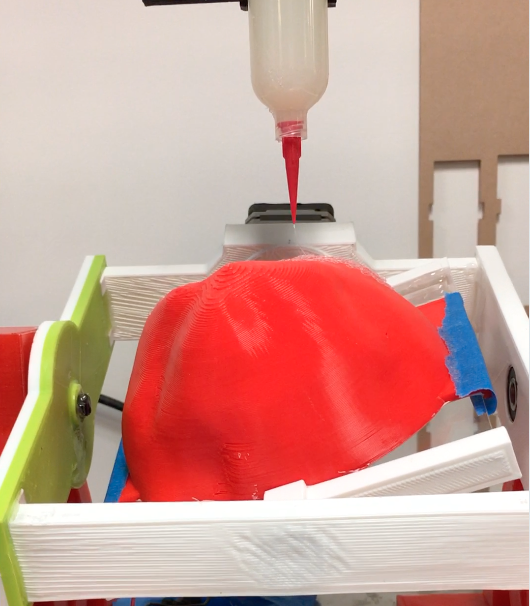
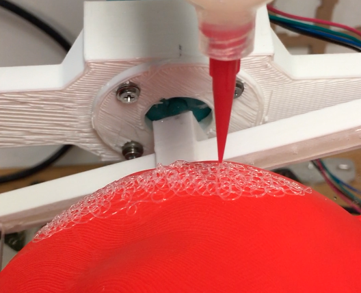
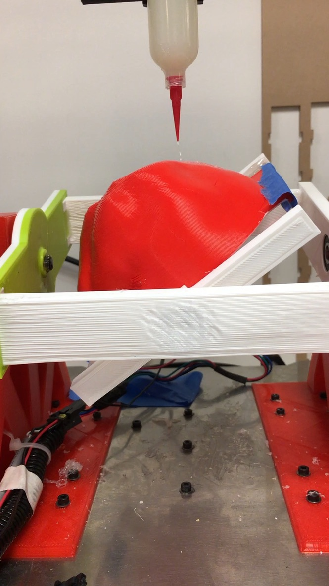
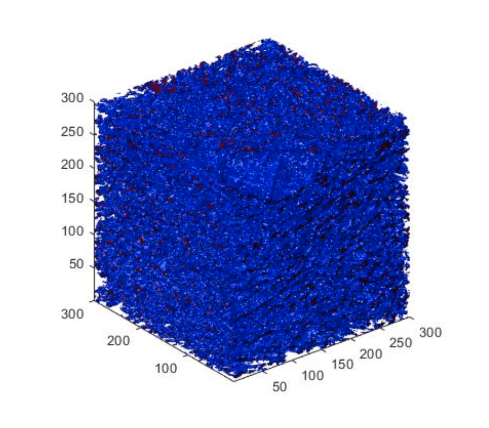
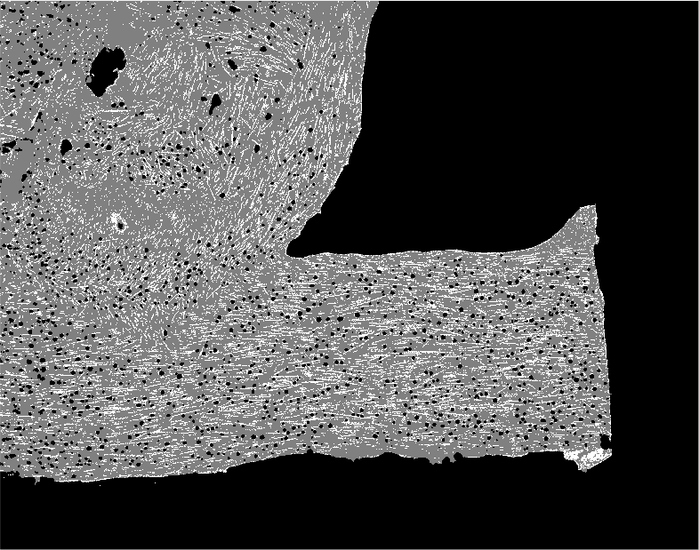

William van den Bogert is a senior who will receive his B.S.E. in Mechanical Engineering in the spring of 2021.

## Projects

### 5-Axis 3D Printer

This 5-axis 3D printer is one of my ongoing projects for the Wu Manufacturing Research Center at the University of Michigan. It utilizes the usual 3D printer technology with two additional axes, in order to be able to print on top of as well as perpendicular to contoured surfaces. I took the initiative to develop the complicated program for generating the printer's instructions, and to build compact hardware for the system. The applications for such technology include prosthetics and orthotics, where the user will have parts specifically tailored to their comfort.

### Automatic CT Scan Segmentation

The Wu Manufacturing Research Center had a couple projects dealing with optimizing manufacturing processes, particularly with 3D printing. Studying the interior structure of manufactured parts could lead to improvements in the manufacturing process. So, I developed a MATLAB program to automatically segment CT Scans of a 3D printed Nylon part, with short carbon fibers embedded. The program was designed to separate the carbon fibers from the rest in order to study their orientation, and to study porosity of the part.

