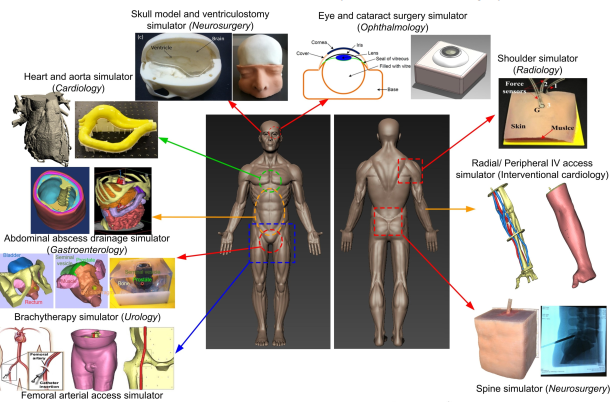

- Transform the traditional “see one, do one, teach one” clinical education to “see one, practice many with simulator, do one, teach one” with the goal to improve patient safety
- Use 3D printing as the enabling technology for anatomically-accurate clinical simulators with novel phantom materials with the same tactile, ultrasound, mechanical and other properties
- Simulators built: Ventriculostomy, Eye and cataract surgery, Heart and aorta, Abdominal abscess access, Prostate brachytherapy, Femoral, radial and peripheral vascular access, endonasal approach to the skull base, and minimally invasive spinal surgery

- [Femoral arterial access simulator](http://onlinelibrary.wiley.com/doi/10.1002/ccd.26256/full)
- [Torque for screw placement for orthopaedic surgery](http://journals.lww.com/jorthotrauma/Abstract/2016/05000/Two_Finger_Tightness___What_Is_It__Measuring.11.aspx)
- [Endoscopic endonasal bone drilling in brain surgery](http://thejns.org/doi/10.3171/2015.3.JNS1552)
- [Ventricular drain placement simulator for neurosurgery](http://thejns.org/doi/10.3171/2014.12.JNS141867)
- [Cerebral artery for aneurysm](http://proceedings.asmedigitalcollection.asme.org/proceeding.aspx?articleid=2558719)
